<p align="center">
  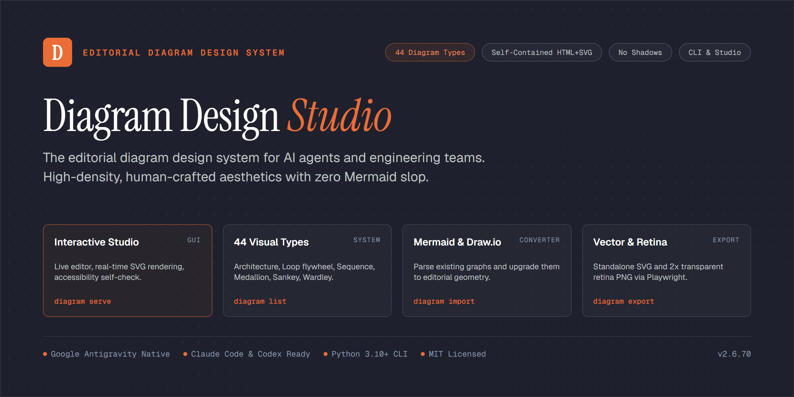
</p>

<p align="center">
  <a href="https://github.com/cathrynlavery/diagram-design/releases"></a>
  <a href="#license"></a>
  <a href="https://python.org"></a>
  <a href="#44-visual-types-catalog"></a>
  <a href="#diagram-design-studio-interactive-gui"></a>
  <a href="#ai-agent-workflow-generate-from-spec-files"></a>
</p>

---

## Overview

**Diagram Design Studio** is an editorial diagram design system, CLI toolchain, and interactive web studio for AI agents and engineering teams.

Forty-four canonical visual types. Self-contained HTML + SVG files. **Zero shadows. Zero Mermaid slop.** Pure editorial typography (*Instrument Serif* + *Geist*) and clean 4px geometric layout.

> **Core Philosophy:** *The highest-quality move is deletion.* Target density is 4/10. Every node earns its place. Coral accent (`#eb6c36`) is reserved strictly for 1–2 focal elements per diagram so the reader immediately grasps what matters.

---

## Key Highlights

- 🎨 **44 Visual Diagram Types**: Architecture, Flywheel Loop, Data Flow, Medallion, Sequence, State Machine, Sankey, Wardley Maps, Axonometric Plans, and more.
- 🖥️ **Interactive Design Studio (`diagram serve`)**: Full web application with a 44-type interactive gallery, a real-time live editor with instant SVG preview, and a Mermaid converter.
- 🤖 **AI-Agent Native**: Seamlessly integrated with **Google Antigravity**, **Claude Code**, **Codex**, **Factory Droid**, and **Pi**. Feed any markdown spec or architecture doc to the AI to generate production-ready diagrams.
- ⚡ **Self-Contained & Zero Dependencies**: Every diagram is a single standalone `.html` file with inline SVG, accessible `<title>` and `<desc>`, and embedded styling. Opens offline in any browser.
- 🔄 **Mermaid & Draw.io Converter**: Ingest messy auto-routed graphs from `.mmd`, `.drawio`, or `.excalidraw` and upgrade them to editorial geometry.
- 📸 **Retina Export Engine**: Export any diagram to standalone `.svg` and retina 2x transparent `.png` with one CLI command via Playwright.

---

## Diagram Design Studio (Interactive GUI)

Launch the built-in Diagram Design Studio to browse, live-edit, and export diagrams:

```bash
diagram serve --open
```

The studio opens at `http://127.0.0.1:8765`:

<p align="center">
  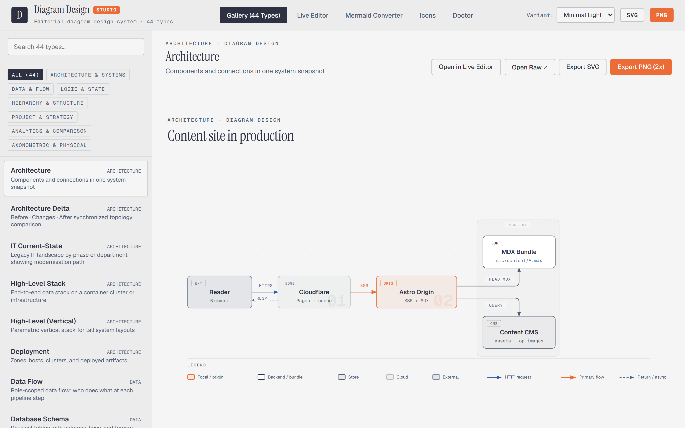
</p>

### Studio Capabilities:

1. **Gallery View (44 Types)**: Explore all canonical diagram types with category filtering, search, and one-click variant switching (*Minimal Light*, *Minimal Dark*, *Full Editorial*, *Motion*, *Terminal*).
2. **Live Editor**: Edit HTML+SVG markup with real-time canvas preview, integrated accessibility self-check, and instant SVG/PNG downloads.
3. **Mermaid Converter**: Paste existing Mermaid syntax to extract intermediate structural representation (IR) and map it to an editorial diagram type.
4. **Icons Gallery**: Browse 87 curated monochrome technical & cloud icons (AWS, Azure, Docker, Kubernetes, Postgres, GitHub…).
5. **Doctor**: Instant diagnostic panel checking Python environment, templates, and Playwright Chromium readiness.

<p align="center">
  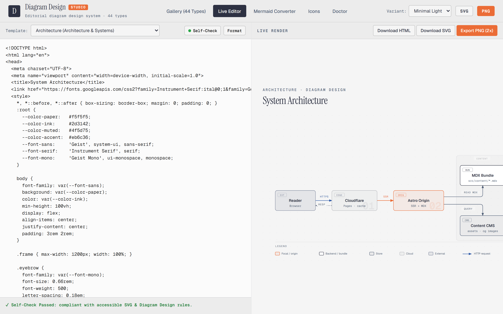
</p>

---

## Quick Start

### 1. Installation

Clone and install in editable mode:

```bash
git clone https://github.com/cathrynlavery/diagram-design.git
cd diagram-design

# Install Python package and CLI
pip install -e .

# Install Playwright Chromium for retina PNG exports
playwright install chromium
```

### 2. Verify Setup

Run the built-in diagnostic tool:

```bash
diagram doctor
```

```text
Diagram Design Doctor v2.6.70
==================================================
[OK  ] Python Version                   : Python 3.13.15
[OK  ] Assets & Templates               : Found 5 templates and 204 examples
[OK  ] Diagram Types                    : Registered all 46 canonical diagram types
[OK  ] PNG Rasterizer (Playwright)      : Chromium available
[OK  ] Antigravity Global Skill         : Installed in global config
[OK  ] Antigravity Workspace Skill      : Installed in workspace
```

### 3. CLI Command Reference

The `diagram` command provides everything needed to scaffold, validate, and export diagrams:

```bash
# List all 44 canonical diagram types
diagram list

# Filter types by category
diagram list --category "Architecture & Systems"

# Show detailed specification & rules for a type
diagram info architecture

# Scaffold a new diagram HTML file
diagram new architecture --title "Payment Gateway Service" --output my-arch.html

# Verify diagram SVG accessibility & design compliance
diagram check my-arch.html

# Export to standalone SVG and retina 2x transparent PNG
diagram export my-arch.html --format both

# Import and analyze a Mermaid, Draw.io, or Excalidraw diagram
diagram import flowchart.mmd

# Launch interactive Diagram Design Studio
diagram serve --open
```

---

## AI Agent Workflow: Generate from Spec Files

You can instruct your AI assistant (**Google Antigravity**, **Claude Code**, etc.) to generate diagrams directly from an explanatory specification file or architecture RFC.

<p align="center">
  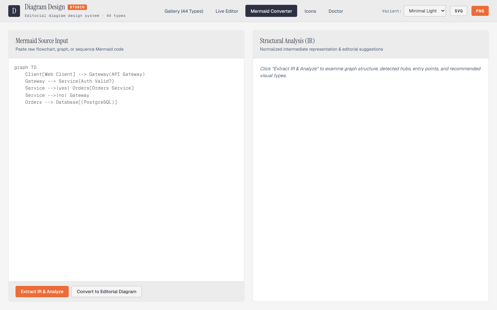
</p>

### Example Prompts:

```text
"Read my docs/architecture-spec.md and generate an editorial architecture diagram in HTML+SVG."
```

```text
"Analyze src/auth/service.py and generate a sequence diagram showing the JWT refresh flow."
```

```text
"Convert this Mermaid file database-flow.mmd into a clean editorial data-flow diagram."
```

### How the Agent Executes:

1. **Semantic Extraction**: The agent reads the explanatory document, identifying components, boundaries, and data handoffs.
2. **Type Selection**: It matches the problem to the most effective of the **44 visual types** (e.g., *Medallion* for data tiering, *Loop* for feedback flywheels, *Architecture Delta* for migrations).
3. **Editorial Generation**: It outputs a self-contained `.html` file adhering to the design system (Instrument Serif titles, Geist sans nodes, Geist Mono labels, 4px grid alignment, and max 1–2 coral focal nodes).
4. **Automated Verification**: It runs `diagram check <file.html>` to verify valid SVG tags, correct viewbox aspect ratio, and accessibility `<title>` / `<desc>` elements.
5. **Retina Export**: It optionally generates high-res PNG and vector SVG for slides or documentation.

---

## 44 Visual Types Catalog

<table>
<tr>
  <td align="center" width="33%"><a href="docs/screenshots/architecture.png">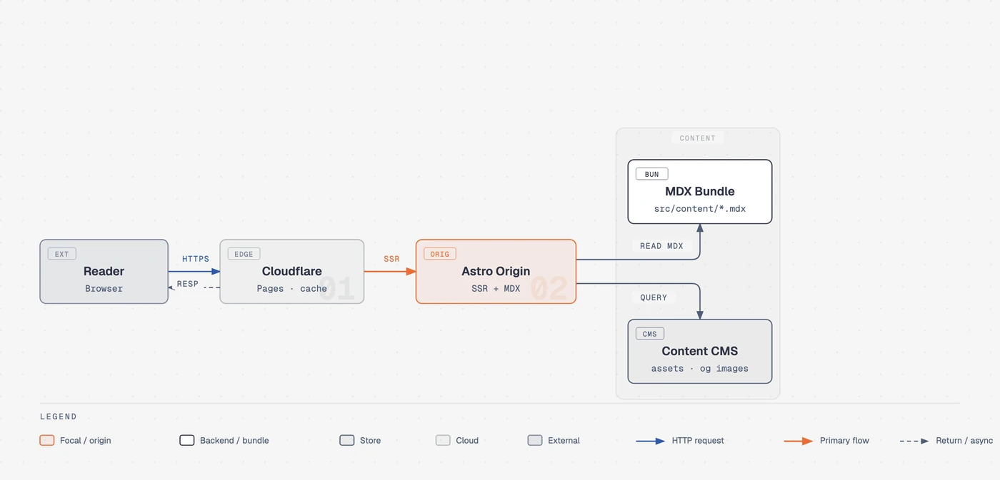</a><br><b>Architecture</b><br><sub>Components + connections</sub></td>
  <td align="center" width="33%"><a href="docs/screenshots/it-state.png">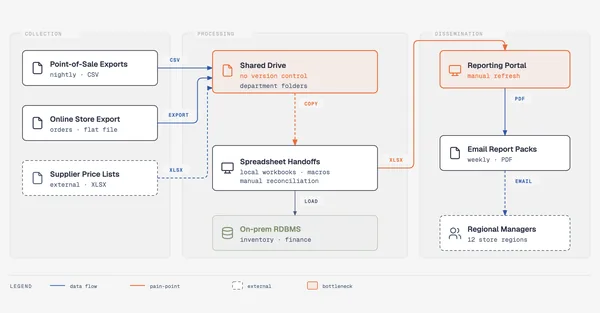</a><br><b>IT current-state</b><br><sub>Legacy landscape + modernization</sub></td>
  <td align="center" width="33%"><a href="docs/screenshots/flowchart.png">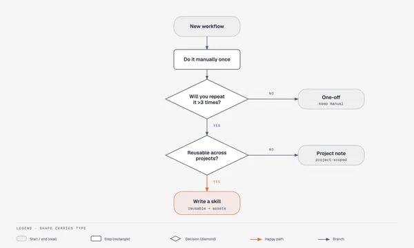</a><br><b>Flowchart</b><br><sub>Decision logic</sub></td>
</tr>
<tr>
  <td align="center"><a href="docs/screenshots/sequence.png">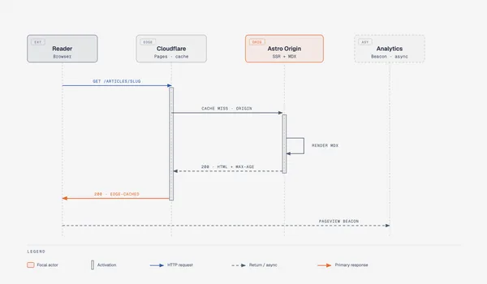</a><br><b>Sequence</b><br><sub>Messages over time</sub></td>
  <td align="center"><a href="docs/screenshots/state.png">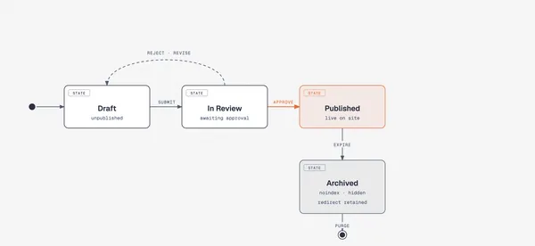</a><br><b>State machine</b><br><sub>States + transitions</sub></td>
  <td align="center"><a href="docs/screenshots/er.png">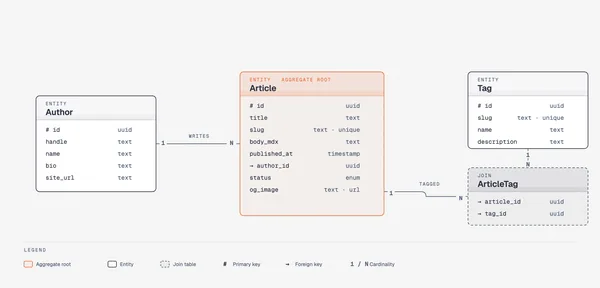</a><br><b>ER / data model</b><br><sub>Entities + fields</sub></td>
</tr>
<tr>
  <td align="center"><a href="docs/screenshots/timeline.png">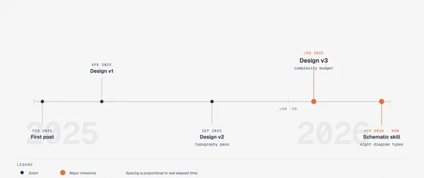</a><br><b>Timeline</b><br><sub>Events on an axis</sub></td>
  <td align="center"><a href="docs/screenshots/swimlane.png">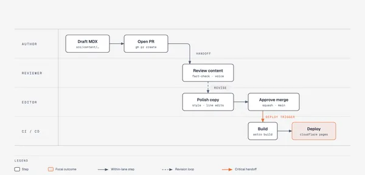</a><br><b>Swimlane</b><br><sub>Cross-functional flow</sub></td>
  <td align="center"><a href="docs/screenshots/quadrant.png">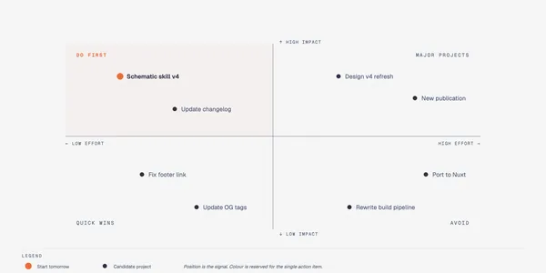</a><br><b>Quadrant</b><br><sub>Two-axis positioning</sub></td>
</tr>
<tr>
  <td align="center"><a href="docs/screenshots/radar.png">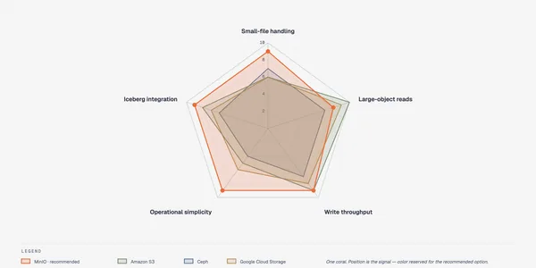</a><br><b>Radar / spider</b><br><sub>Multi-axis comparison</sub></td>
  <td align="center"><a href="docs/screenshots/loop.png">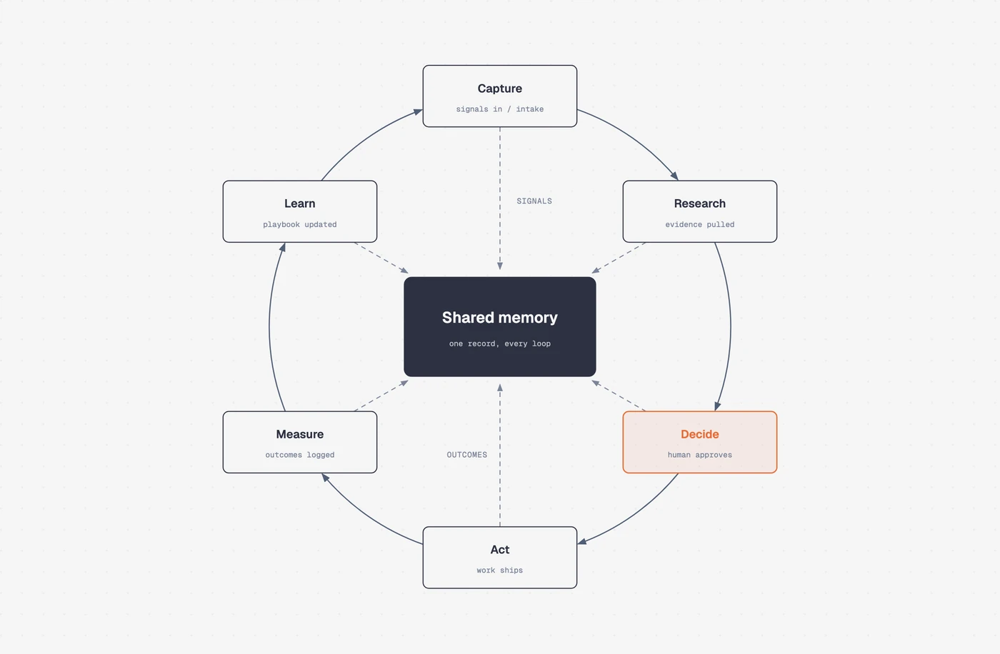</a><br><b>Loop / flywheel</b><br><sub>Reinforcing cycle + shared hub</sub></td>
  <td align="center"><a href="docs/screenshots/nested.png">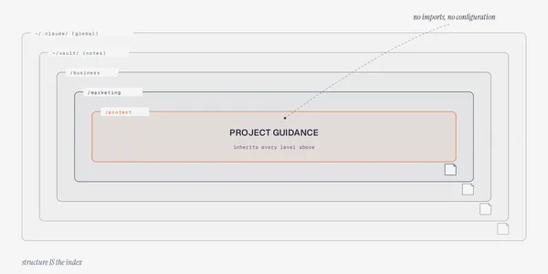</a><br><b>Nested</b><br><sub>Hierarchy by containment</sub></td>
</tr>
<tr>
  <td align="center"><a href="docs/screenshots/tree.png">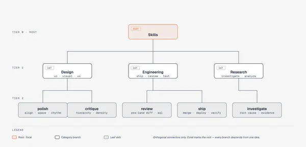</a><br><b>Tree</b><br><sub>Parent → children</sub></td>
  <td align="center"><a href="docs/screenshots/org-chart.png">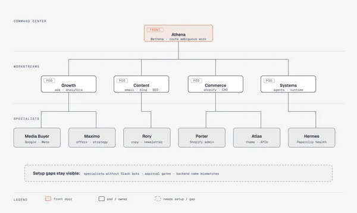</a><br><b>Org chart</b><br><sub>Ownership + routing</sub></td>
  <td align="center"><a href="docs/screenshots/layers.png">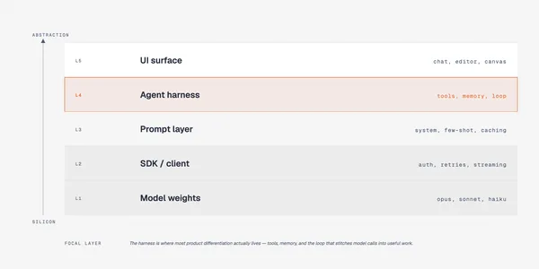</a><br><b>Layer stack</b><br><sub>Stacked abstractions</sub></td>
</tr>
<tr>
  <td align="center"><a href="docs/screenshots/venn.png">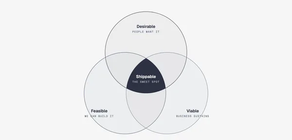</a><br><b>Venn</b><br><sub>Set overlap</sub></td>
  <td align="center"><a href="docs/screenshots/pyramid.png">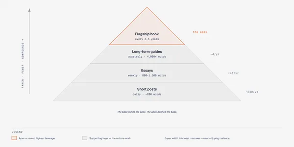</a><br><b>Pyramid / funnel</b><br><sub>Ranked hierarchy or drop-off</sub></td>
  <td align="center"><a href="docs/screenshots/bar.png">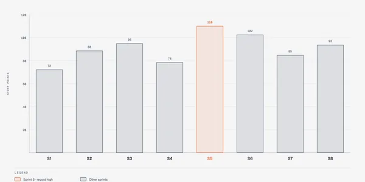</a><br><b>Bar chart</b><br><sub>Categorical comparison</sub></td>
</tr>
<tr>
  <td align="center"><a href="docs/screenshots/treemap.png">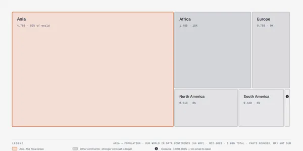</a><br><b>Treemap</b><br><sub>Part-of-whole by area</sub></td>
  <td align="center"><a href="docs/screenshots/line.png">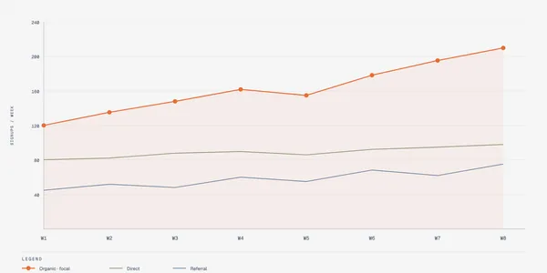</a><br><b>Line chart</b><br><sub>Trends over time</sub></td>
  <td align="center"><a href="docs/screenshots/gantt.png">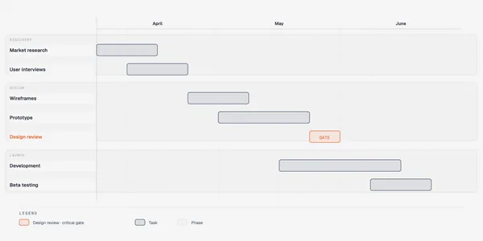</a><br><b>Gantt</b><br><sub>Tasks + phases on a timeline</sub></td>
</tr>
<tr>
  <td align="center"><a href="docs/screenshots/scatter.png">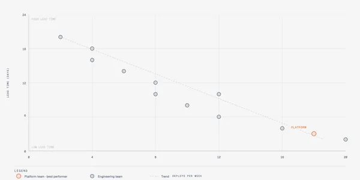</a><br><b>Scatter plot</b><br><sub>Distribution + correlation</sub></td>
  <td align="center"><a href="docs/screenshots/high-level.png">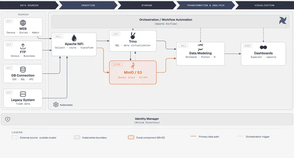</a><br><b>High-Level</b><br><sub>End-to-end stack on a cluster</sub></td>
  <td align="center"><a href="docs/screenshots/process.png">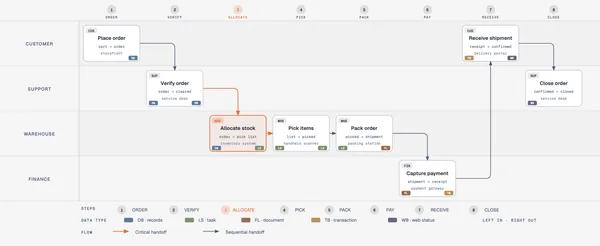</a><br><b>Process</b><br><sub>Multi-actor sequential workflow</sub></td>
</tr>
<tr>
  <td align="center"><a href="docs/screenshots/medallion.png">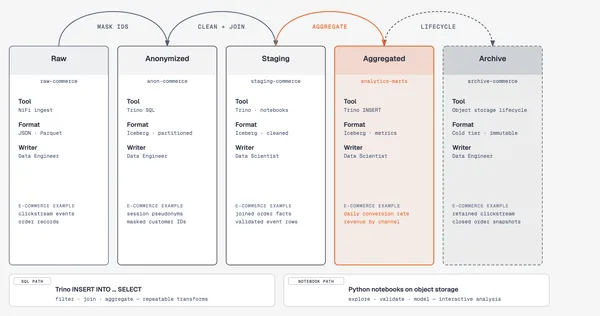</a><br><b>Medallion</b><br><sub>Multi-tier data storage</sub></td>
  <td align="center"><a href="docs/screenshots/data-flow.png">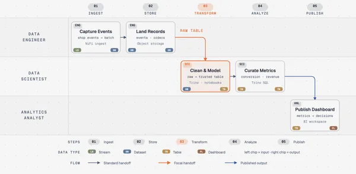</a><br><b>Data flow</b><br><sub>Role-scoped pipeline steps</sub></td>
  <td align="center"><a href="docs/screenshots/dp-integration.png">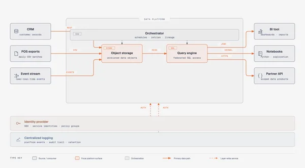</a><br><b>DP integration</b><br><sub>Sources → core → consumers</sub></td>
</tr>
<tr>
  <td align="center"><a href="docs/screenshots/dp-security-matrix.png">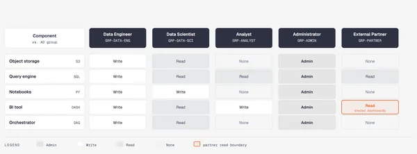</a><br><b>DP security matrix</b><br><sub>Per-role access permissions</sub></td>
  <td align="center"><a href="docs/screenshots/sankey.png">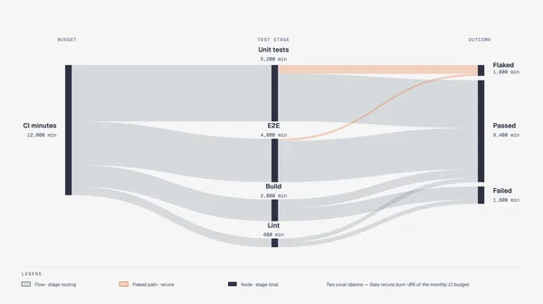</a><br><b>Sankey</b><br><sub>Quantities that split + merge</sub></td>
  <td align="center"><a href="docs/screenshots/fishbone.png">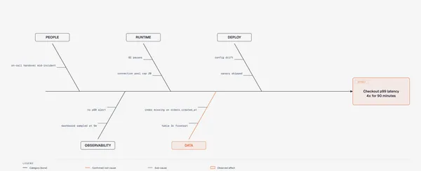</a><br><b>Fishbone</b><br><sub>Grouped causes → one effect</sub></td>
</tr>
<tr>
  <td align="center"><a href="docs/screenshots/wardley.png">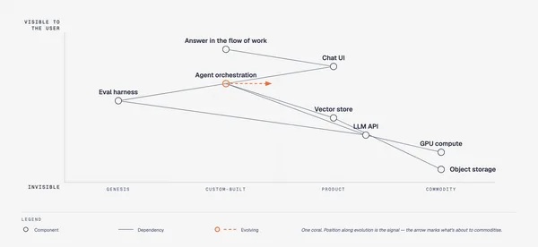</a><br><b>Wardley map</b><br><sub>Value chain × evolution</sub></td>
  <td align="center"><a href="docs/screenshots/kanban.png">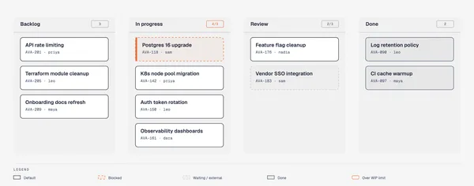</a><br><b>Kanban</b><br><sub>Work in progress by state</sub></td>
  <td align="center"><a href="docs/screenshots/journey.png">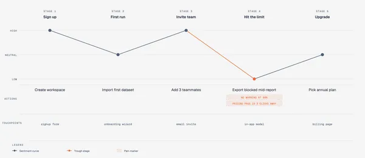</a><br><b>User journey</b><br><sub>Stages, actions + sentiment</sub></td>
</tr>
<tr>
  <td align="center"><a href="docs/screenshots/deployment.png">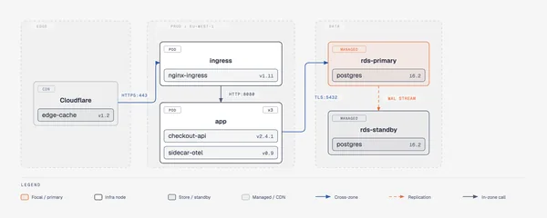</a><br><b>Deployment</b><br><sub>Zones, hosts + artifacts</sub></td>
  <td align="center"><a href="docs/screenshots/dependency.png">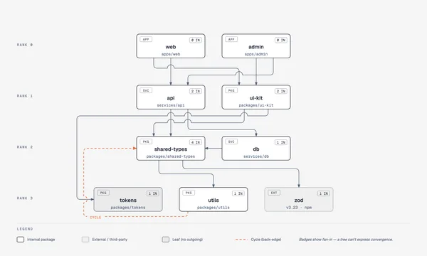</a><br><b>Dependency graph</b><br><sub>Fan-in, ranks + cycles</sub></td>
  <td align="center"><a href="docs/screenshots/uml-class.png">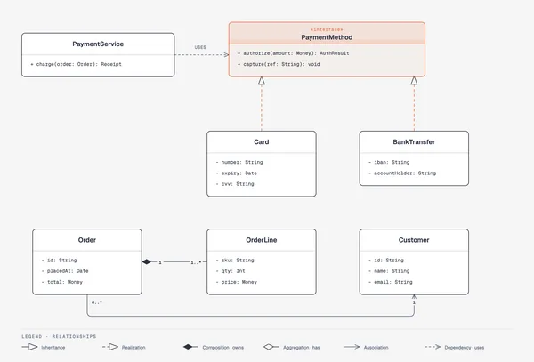</a><br><b>UML class</b><br><sub>Classes, operations + typed relations</sub></td>
</tr>
<tr>
  <td align="center"><a href="docs/screenshots/story-map.png">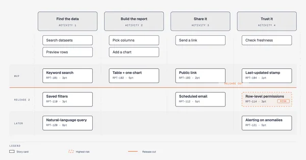</a><br><b>Story map</b><br><sub>Backbone × release slices</sub></td>
  <td align="center"><a href="docs/screenshots/db-schema.png">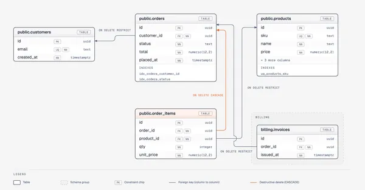</a><br><b>Database schema</b><br><sub>Physical tables + column FKs</sub></td>
  <td align="center"><a href="docs/screenshots/polar.png">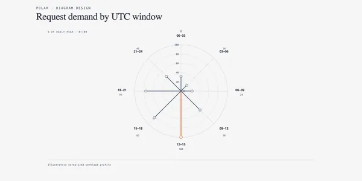</a><br><b>Polar chart</b><br><sub>Cyclic magnitude · linear radius</sub></td>
</tr>
<tr>
  <td align="center" width="33%"><a href="docs/screenshots/waterfall.png">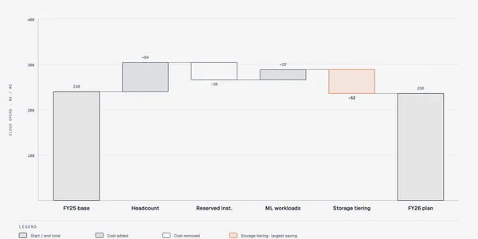</a><br><b>Waterfall</b><br><sub>Running total + signed bridges</sub></td>
  <td align="center" width="33%"><a href="docs/screenshots/architecture-delta.png">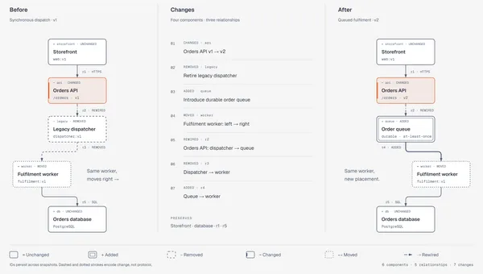</a><br><b>Architecture delta</b><br><sub>Before · Changes · After topology</sub></td>
  <td align="center" width="33%"><a href="docs/screenshots/exploded.png">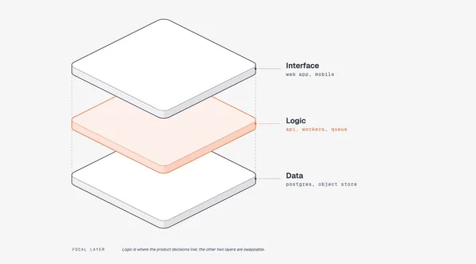</a><br><b>Exploded axonometric</b><br><sub>Parts pulled apart on one axis</sub></td>
</tr>
<tr>
  <td align="center" width="33%"><a href="docs/screenshots/axonometric-plan.png">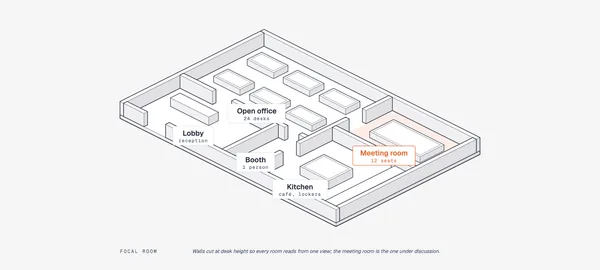</a><br><b>Axonometric plan</b><br><sub>Rooms and buildings on one plate</sub></td>
  <td align="center" width="33%"><a href="docs/screenshots/heatmap.png">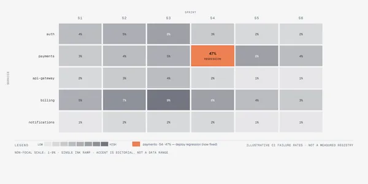</a><br><b>Heatmap</b><br><sub>Value per row × column cell</sub></td>
  <td align="center" width="33%"></td>
</tr>
</table>

---

## The Design System

```text
Tokens:
  paper:   #f5f5f5 (light) / #2d3142 (dark)
  ink:     #2d3142 (light) / #f5f5f5 (dark)
  muted:   #4f5d75 (light) / #bfc0c0 (dark)
  accent:  #eb6c36 (light) / #f08a59 (dark)

Typography:
  title:      Instrument Serif (400, italic for callouts)
  node-name:  Geist (600, sans-serif)
  sublabels:  Geist Mono (400–500, technical ports, endpoints, types)
```

- **Zero Shadows**: Crisp hairline borders (`1px solid rgba(45, 49, 66, 0.15)`), maximum border radius of 10px.
- **4px Spatial Grid**: Every coordinate, dimension, padding, and gap is strictly divisible by 4.
- **Focal Discipline**: Maximum 1–2 coral nodes per diagram. If everything is highlighted, nothing is highlighted.

---

## Agent Host Setup

### Google Antigravity
Integrated natively via `.agents/skills/diagram-design` and `~/.gemini/config/skills/diagram-design`:
```bash
# Verify readiness
diagram doctor

# Launch studio
diagram serve --open
```

### Claude Code
```text
/plugin marketplace add cathrynlavery/diagram-design
/plugin install diagram-design@diagram-design
```

### Codex
```bash
codex plugin marketplace add cathrynlavery/diagram-design
codex plugin add diagram-design@diagram-design
```

### GitHub Copilot
```bash
copilot plugin marketplace add cathrynlavery/diagram-design
copilot plugin install diagram-design@diagram-design
```

### Factory Droid
```bash
droid plugin marketplace add https://github.com/cathrynlavery/diagram-design
droid plugin install diagram-design@diagram-design --scope user
```

---

## Contributing & License

Contributions are welcome! Please read [CONTRIBUTING.md](CONTRIBUTING.md) and [CODE_OF_CONDUCT.md](CODE_OF_CONDUCT.md).

Original concept and design system created by [Cathryn Lavery](https://github.com/cathrynlavery). Enhanced with CLI, Python package, Playwright export engine, and interactive Studio GUI.

Released under the [MIT License](LICENSE).
